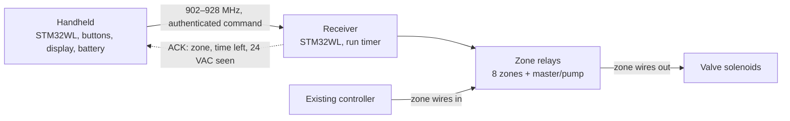

# Irrigation Remote

**An open, low-cost handheld radio remote for residential irrigation systems.** Start a sprinkler zone from anywhere on the property, see that it actually came on, and stop it, on any brand of 24 VAC controller.

> [!WARNING]
> **Research and design stage. Nothing has been built or tested on hardware yet.**
> The portable firmware library passes unit tests on a PC, and that is all so far. Every hardware, radio and safety feature described below is a design goal, not a demonstrated result.

## The problem

When an irrigation technician services a system, they spend much of the visit walking between the controller and the zones: start zone 3, walk out, check the heads, walk back, start zone 4. A handheld remote removes the walking. The established product for this job is the TRC Commander, a handheld FM transmitter with receivers that attach to the controller. It works well, but it is expensive: one dealer lists a single Commander receiver at over $1,100 ([TRC-014](docs/research/trc-commander.md)).

The brands' own remotes, such as Hunter ROAM and Rain Bird LIMR, are cheaper, but each plugs into its own brand's controller port. A technician who meets Hunter, Rain Bird, Irritrol and others in one week would need a remote for each.

## What this project is building

A handheld transmitter and a receiver that does the TRC Commander's job for a fraction of the cost, working with whatever 24 VAC controller is on site.

The first unit is a prototype for an irrigation company's own maintenance work. The project is also a deliberate learning exercise in sub-GHz radio, embedded security and taking a board from bench to field, so the design, the research and the reasoning are all written down here in the open.

### How it is meant to work



1. The technician picks a zone and a run time on the handheld.
2. The handheld sends an authenticated command over the 902–928 MHz ISM band (LoRa proposed for v1).
3. The receiver checks the command, switches that zone's relay, and replies with what it did, including whether 24 VAC is actually present on the zone output.
4. The receiver's own timer ends the run. If the radio link drops or the power fails, the zone still stops.

### Design principles

| Principle | How |
|---|---|
| **Works with any brand** | The receiver's relays sit in series with the controller's zone wires (the "in-line" route), so it needs no brand-specific protocol. TRC's universal receiver uses the same idea. |
| **Fails safe** | The receiver holds the run timer. No message is needed to end a run, relays are normally open, and power-up is all-off. |
| **Confirms, doesn't assume** | Every command is acknowledged. Tier 2 confirmation senses 24 VAC on the output; sensing solenoid current is a stretch goal. |
| **Authenticated** | AES-128-CMAC on every frame plus rolling counters, so a neighbour's remote or a recording of yours cannot start a zone. |
| **One zone at a time** | Switching zones is break-before-make. Hunter's ROAM behaves the same way: starting one station stops the running one ([HUN-003](docs/research/hunter.md)). |
| **Testable on a PC** | The protocol and state machines live in a portable C library with no hardware calls and full host unit tests. |

**v1 scope:** residential systems, 8 zones plus a master valve or pump output, one handheld paired with one receiver, run times up to 2 hours (20 minutes by default, matching TRC).

**Not in v1:** programming controller schedules, several zones at once, a phone or cloud interface, or selling units.

## Brand research

The in-line route works with any 24 VAC controller. Optional adapters that speak a controller's own remote port would avoid rewiring and lift the zone limit. The catch is that vendors don't publish those ports, so this repository collects what is known about each brand, with every claim labelled by how well it is supported.

| Brand | Port | What is known |
|---|---|---|
| TRC Commander | 37-pin station cable; DCI logic converters | Station cable pinout documented. DCI signals not public. |
| Hunter | SmartPort (REM wire) | Single-wire, pulse-width protocol reverse-engineered by community projects. Not yet checked on real hardware. |
| Rain Bird | 5-pin and 6-pin remote ports | 5-pin partly measured by one forum poster (SPI-like). 6-pin unknown. Rain Bird says full specs for a third-party port adapter are available from its sales reps (RB-031). |
| Irritrol / Toro | RJ-11, RJ-45, 5-pin header | Connectors documented, signals not. FCC schematics withheld. |
| Rain Master, Weathermatic, Superior / HIT Logic, Griswold, Orbit | — | Not yet researched. |

Claims are `confirmed` (measured by this project), `documented` (official source), `reported` (third party), `inferred` or `unknown`. None are `confirmed` yet; that waits for logic-analyzer captures of real equipment. See [docs/research](docs/research/) and the [measurement plan](docs/research/measurement-plan.md).

## Status and roadmap

| Phase | Goal | State |
|---|---|---|
| 0. Research and decisions | Close key unknowns, agree scope | **In progress** |
| 1. Radio link on dev boards | Two STM32WL boards exchange authenticated messages; measure range and battery current | Waiting for 902–928 MHz boards |
| 2. Receiver on the bench | Relays, voltage sense, run timer and fail-safe with 24 VAC and real solenoids | Not started |
| 3. First hardware revision | KiCad boards for handheld and receiver; bring-up | Not started |
| 4. Field trial | Real site, real controller, written trial notes | Not started |
| 5. Brand adapters (optional) | Remote-port adapters where signals are documented and testable | Not started |

**Done so far:**

- Research on four brands: 73 claims, each with a source and access date.
- Requirements, architecture, safety and regulatory notes, open questions.
- [Radio protocol v0.1](docs/protocol/v0.1.md) (draft).
- Portable firmware library in `firmware/core`: AES-128 and CMAC (checked against FIPS-197 and RFC 4493 vectors), framing, replay protection, the receiver run timer, and receiver and handheld message handling. Host-tested only.
- STM32WL port scaffold: startup code, linker script and stub drivers. Builds only; never run.

## Repository layout

| Path | Contents |
|---|---|
| [`docs/`](docs/) | Project site source: requirements, architecture, research, protocol, decisions (ADRs), versioning |
| [`firmware/core/`](firmware/core/) | Portable C11 library, no hardware calls |
| [`firmware/tests/`](firmware/tests/) | Host unit tests (CMake and CTest) |
| [`firmware/port/stm32wl/`](firmware/port/stm32wl/) | STM32WL receiver port |
| [`hardware/`](hardware/) | KiCad projects, one folder per board (none yet) |
| [`captures/`](captures/) | Logic-analyzer captures of real controllers, each with metadata (none yet) |
| [`tools/`](tools/) | Claim checker, docs build hooks, future protocol decoders |
| [`backlog/`](backlog/) | Drafts of research and engineering issues |

## Getting started

**Read the docs locally** (Python 3.10+):

```sh
pip install -r requirements-docs.txt
mkdocs serve        # http://127.0.0.1:8000
```

**Run the firmware tests** (CMake 3.20+ and any C compiler):

```sh
cmake -S firmware -B build/host
cmake --build build/host
ctest --test-dir build/host --output-on-failure
```

**Build the STM32WL port** (arm-none-eabi-gcc): see [docs/firmware.md](docs/firmware.md).

CI runs the docs build with link checking, host tests under GCC and Clang with sanitizers, and the ARM build on every push and pull request.

## How the project is run

- **Evidence first.** Every claim about another vendor's product has an ID, a status, a source and an access date. Sources are summarised and linked, never copied. Conflicting sources stay side by side.
- **Clean-room code.** Community projects (some GPL) are read to understand protocols, never copied. All code here is original.
- **Honest status.** Anything not run on hardware is marked untested.
- **Versioned separately.** Research snapshots (`research-YYYY.MM`), protocol (`proto-vX.Y`), firmware (`fw-vX.Y.Z`) and hardware (`hw-revX`) each have their own tags. See [docs/versioning.md](docs/versioning.md).
- **Decisions recorded** as ADRs in [docs/adr](docs/adr/).

Contributions and corrections are welcome, especially captures from real controllers. See [CONTRIBUTING.md](CONTRIBUTING.md).

## Safety

This project works on the **24 VAC side** of irrigation controllers only. Mains wiring is out of scope. The receiver is to be fused and protected against over-voltage (TRC documents damage above 28 VAC). Until it has been built and tested, treat everything here as experimental. Radio use is under FCC Part 15 in the 902–928 MHz band; see [safety and regulatory notes](docs/safety-regulatory.md).

## Licence

[MIT](LICENSE) © 2026 Joel Anthony.

Brand and product names belong to their owners and are used only to describe compatibility. This project is not affiliated with or endorsed by TRC Irrigation Remotes, Hunter Industries, Rain Bird, Irritrol, Toro or any other vendor.
