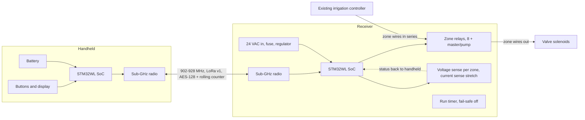

# Architecture (proposal)

Status: proposal. Nothing is built or tested.

## Idea

A handheld transmitter talks over a 902 to 928 MHz radio link to a receiver. The receiver sits in series with the controller's zone wires, so it can switch a zone on and off without caring which brand of controller is attached. That is the in-line route. Brand-specific remote-port adapters are optional extras.

## Two connection routes

| Route | How | Brand dependence | Status |
|---|---|---|---|
| In-line (station line) | Receiver relays sit between the controller's zone terminals and the valves | None for 24 VAC controllers | proposed v1 |
| Remote-port adapter | Receiver speaks a controller's remote-port protocol | One adapter per brand and port generation | optional; signals mostly undocumented |

TRC sells both routes too (a universal receiver on the station line, and DCI logic converters). See [TRC research](research/trc-commander.md).

## Behaviour decisions proposed

- The receiver holds the run timer. A lost link or lost power ends the run.
- One zone at a time. Switching to a new zone turns the old one off first.
- Confirmation tiers: tier 1 command acknowledged by the receiver; tier 2 output voltage seen live (proposed v1); tier 3 solenoid current seen (stretch).
- Power source is open: the receiver's own 24 VAC transformer or the controller's supply. See [open questions](open-questions.md).

## Hardware and radio choices

- STM32WL class SoC on both ends, ideally as a pre-certified module. WB55 (2.4 GHz) is not suited for this link.
- LoRa for v1. Reconsider FSK or other modes if latency or range testing says so.
- KiCad for the boards (Joel also uses Altium).

## Decisions log

Record each accepted architecture decision as an ADR in `docs/adr/` using the template there.
